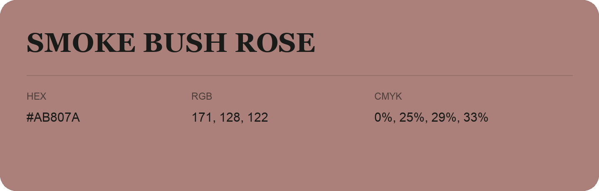

## Smoke Bush Rose

- HEX: #AB807A
- RGB: 171, 128, 122
- CMYK: 0%, 25%, 29%, 33%
- Character: warm, expressive, energetic
- Suggested uses: food brands, expressive identities, promotional accents

- Source images: IMG_9089.JPG
