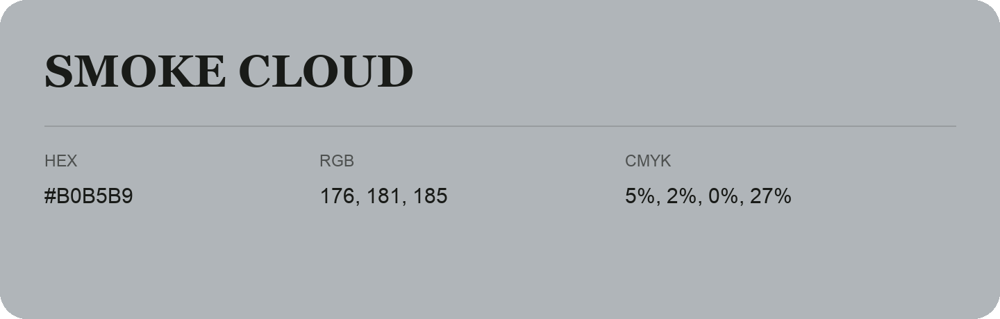

## Smoke Cloud

- HEX: #B0B5B9
- RGB: 176, 181, 185
- CMYK: 5%, 2%, 0%, 27%
- Character: quiet, balanced, understated
- Suggested uses: professional services, minimal identities, supporting backgrounds

- Source images: IMG_9060.JPG

- Data provenance: HEX recovered from page data; cross-checked against the readable source RGB.
