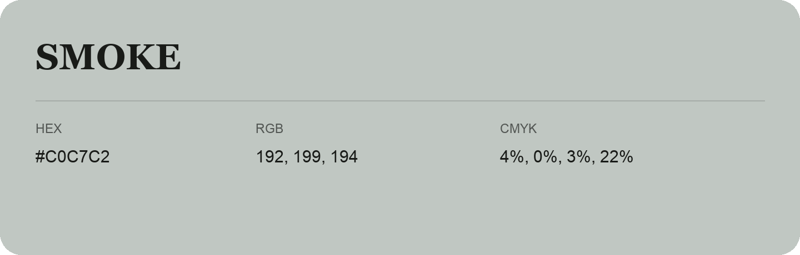

## Smoke

- HEX: #C0C7C2
- RGB: 192, 199, 194
- CMYK: 4%, 0%, 3%, 22%
- Character: quiet, balanced, understated
- Suggested uses: professional services, minimal identities, supporting backgrounds

- Source images: IMG_8998.JPG

- Data provenance: HEX recovered from page data; cross-checked against the readable source RGB.
