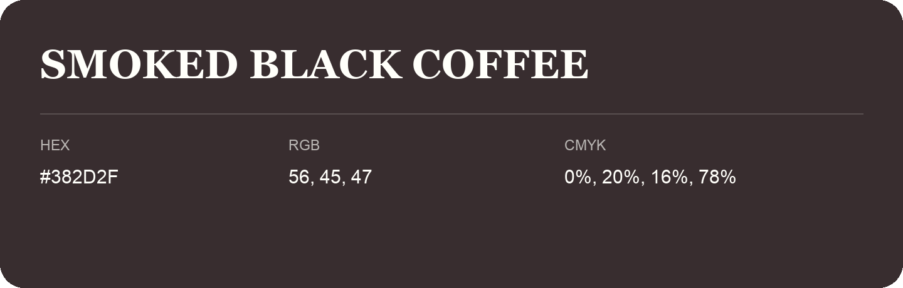

## Smoked Black Coffee

- HEX: #382D2F
- RGB: 56, 45, 47
- CMYK: 0%, 20%, 16%, 78%
- Character: deep, grounded, understated
- Suggested uses: premium packaging, editorial typography, dark backgrounds

- Source images: iCloud Photos 2/IMG_9171.JPG

- Name note: Other distinct shades share this name: [smoked-black-coffee](smoked-black-coffee.md).
