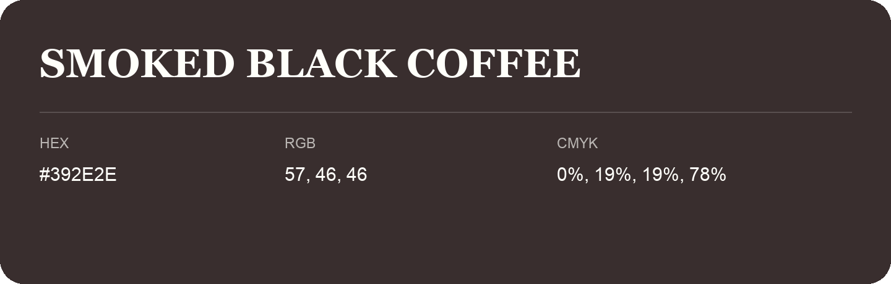

## Smoked Black Coffee

- HEX: #392E2E
- RGB: 57, 46, 46
- CMYK: 0%, 19%, 19%, 78%
- Character: warm, expressive, energetic
- Suggested uses: food brands, expressive identities, promotional accents

- Source images: IMG_9096.JPG

- Name note: Other distinct shades share this name: [smoked-black-coffee-382d2f](smoked-black-coffee-382d2f.md).
