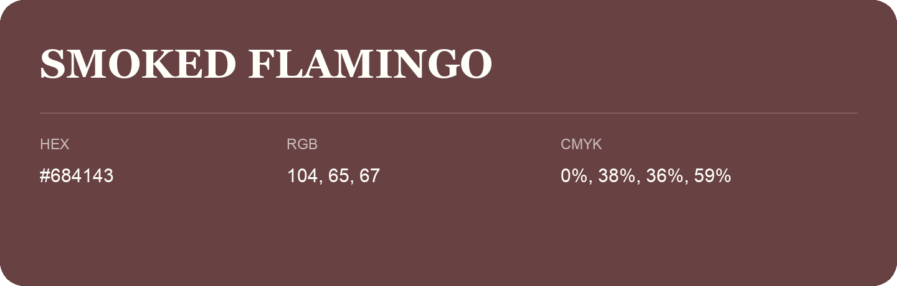

## Smoked Flamingo

- HEX: #684143
- RGB: 104, 65, 67
- CMYK: 0%, 38%, 36%, 59%
- Character: warm, expressive, energetic
- Suggested uses: food brands, expressive identities, promotional accents

- Source images: IMG_9096.JPG
