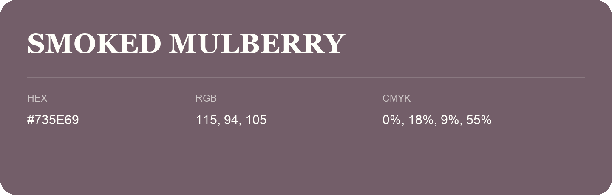

## Smoked Mulberry

- HEX: #735E69
- RGB: 115, 94, 105
- CMYK: 0%, 18%, 9%, 55%
- Character: expressive, imaginative, refined
- Suggested uses: beauty brands, creative businesses, distinctive accents

- Source images: IMG_9102.JPG
