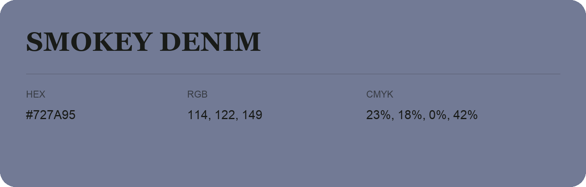

## Smokey Denim

- HEX: #727A95
- RGB: 114, 122, 149
- CMYK: 23%, 18%, 0%, 42%
- Character: cool, composed, dependable
- Suggested uses: professional services, technology brands, calm backgrounds

- Source images: IMG_9110.JPG

- Data provenance: RGB calculated from HEX, matching the page; source image RGB was unreadable.
