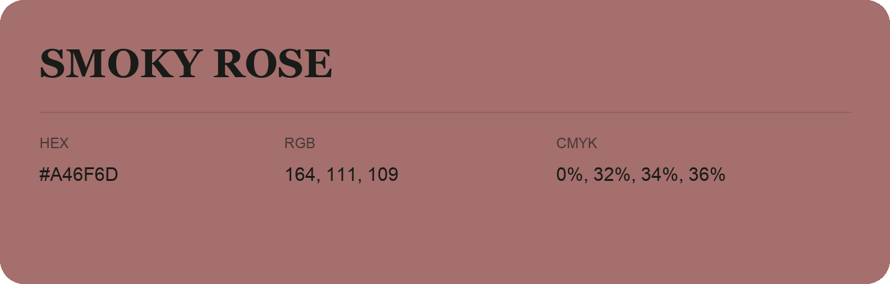

## Smoky Rose

- HEX: #A46F6D
- RGB: 164, 111, 109
- CMYK: 0%, 32%, 34%, 36%
- Character: warm, expressive, energetic
- Suggested uses: food brands, expressive identities, promotional accents

- Source images: IMG_8991.JPG

- Data provenance: RGB calculated from HEX, matching the page; source image RGB was unreadable.
