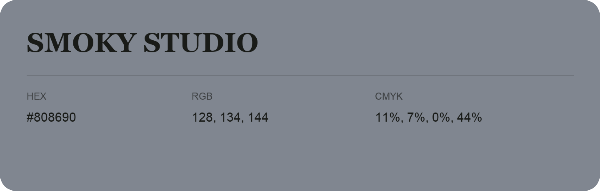

## Smoky Studio

- HEX: #808690
- RGB: 128, 134, 144
- CMYK: 11%, 7%, 0%, 44%
- Character: quiet, balanced, understated
- Suggested uses: professional services, minimal identities, supporting backgrounds

- Source images: IMG_9104.JPG

- Data provenance: RGB calculated from HEX, matching the page; source image RGB was unreadable.
