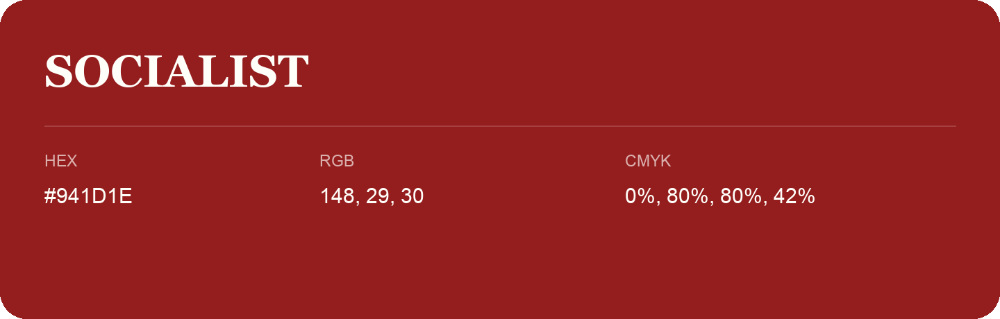

## Socialist

- HEX: #941D1E
- RGB: 148, 29, 30
- CMYK: 0%, 80%, 80%, 42%
- Character: warm, expressive, energetic
- Suggested uses: food brands, expressive identities, promotional accents

- Source images: IMG_9057.JPG
