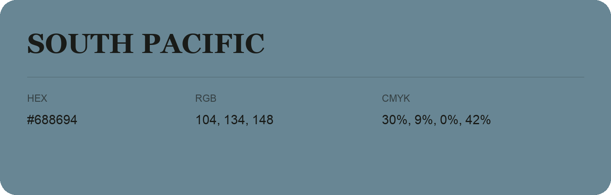

## South Pacific

- HEX: #688694
- RGB: 104, 134, 148
- CMYK: 30%, 9%, 0%, 42%
- Character: calm, fresh, composed
- Suggested uses: wellness brands, coastal hospitality, modern service brands

- Source images: IMG_9067.JPG

- Data provenance: RGB calculated from HEX, matching the page; source image RGB was unreadable.
