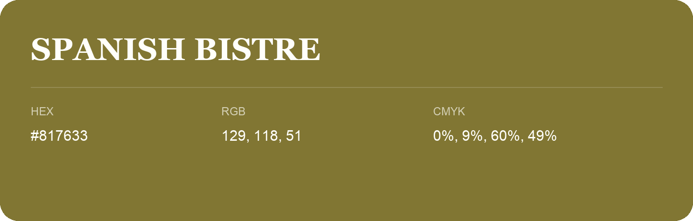

## Spanish Bistre

- HEX: #817633
- RGB: 129, 118, 51
- CMYK: 0%, 9%, 60%, 49%
- Character: sunny, lively, optimistic
- Suggested uses: friendly consumer brands, food packaging, cheerful accents

- Source images: IMG_9056.JPG
