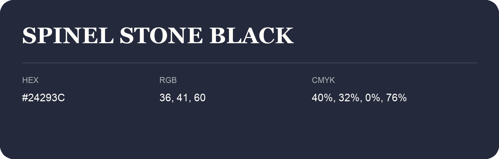

## Spinel Stone Black

- HEX: #24293C
- RGB: 36, 41, 60
- CMYK: 40%, 32%, 0%, 76%
- Character: cool, composed, dependable
- Suggested uses: professional services, technology brands, calm backgrounds

- Source images: IMG_9114.JPG
