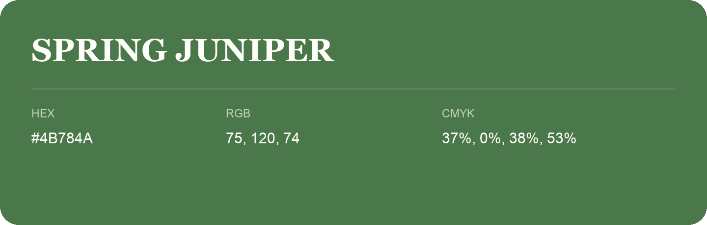

## Spring Juniper

- HEX: #4B784A
- RGB: 75, 120, 74
- CMYK: 37%, 0%, 38%, 53%
- Character: natural, grounded, fresh
- Suggested uses: outdoor businesses, wellness brands, organic packaging

- Source images: IMG_9082.JPG
