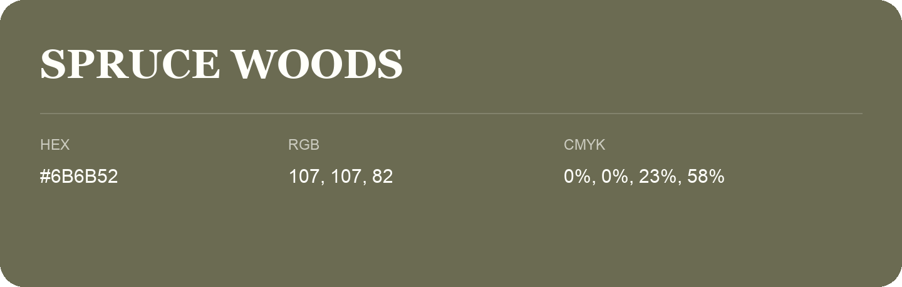

## Spruce Woods

- HEX: #6B6B52
- RGB: 107, 107, 82
- CMYK: 0%, 0%, 23%, 58%
- Character: sunny, lively, optimistic
- Suggested uses: friendly consumer brands, food packaging, cheerful accents

- Source images: IMG_9042.JPG

- Data provenance: RGB calculated from HEX, matching the page; source image RGB was unreadable.
