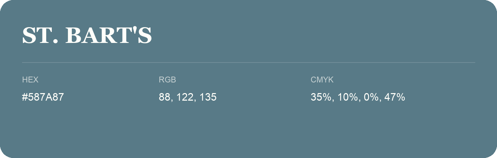

## St. Bart'S

- HEX: #587A87
- RGB: 88, 122, 135
- CMYK: 35%, 10%, 0%, 47%
- Character: calm, fresh, composed
- Suggested uses: wellness brands, coastal hospitality, modern service brands

- Source images: IMG_8994.JPG

- Data provenance: RGB calculated from HEX, matching the page; source image RGB was unreadable.
