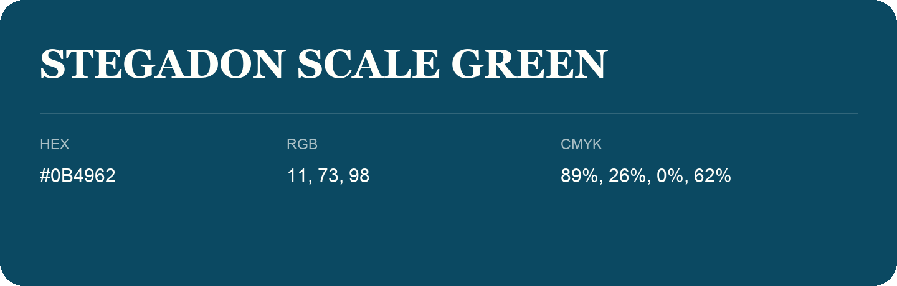

## Stegadon Scale Green

- HEX: #0B4962
- RGB: 11, 73, 98
- CMYK: 89%, 26%, 0%, 62%
- Character: calm, fresh, composed
- Suggested uses: wellness brands, coastal hospitality, modern service brands

- Source images: IMG_9036.JPG

- Data provenance: HEX recovered from page data; cross-checked against the readable source RGB.
