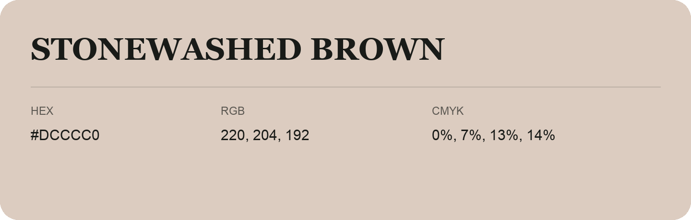

## Stonewashed Brown

- HEX: #DCCCC0
- RGB: 220, 204, 192
- CMYK: 0%, 7%, 13%, 14%
- Character: quiet, balanced, understated
- Suggested uses: professional services, minimal identities, supporting backgrounds

- Source images: IMG_8996.JPG

- Data provenance: HEX recovered from page data; cross-checked against the readable source RGB.
