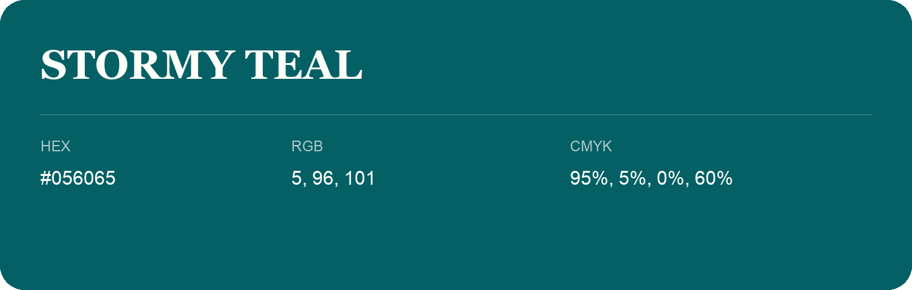

## Stormy Teal

- HEX: #056065
- RGB: 5, 96, 101
- CMYK: 95%, 5%, 0%, 60%
- Character: calm, fresh, composed
- Suggested uses: wellness brands, coastal hospitality, modern service brands

- Source images: IMG_8985.JPG

- Name note: Other distinct shades share this name: [stormy-teal-376c77](stormy-teal-376c77.md).
