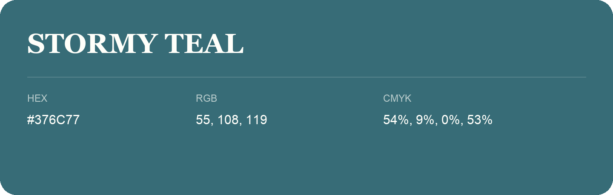

## Stormy Teal

- HEX: #376C77
- RGB: 55, 108, 119
- CMYK: 54%, 9%, 0%, 53%
- Character: calm, fresh, composed
- Suggested uses: wellness brands, coastal hospitality, modern service brands

- Source images: IMG_8991.JPG

- Name note: Other distinct shades share this name: [stormy-teal-056065](stormy-teal-056065.md).
