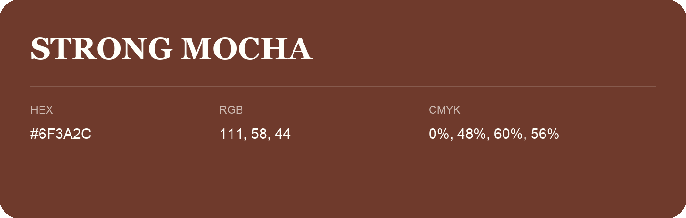

## Strong Mocha

- HEX: #6F3A2C
- RGB: 111, 58, 44
- CMYK: 0%, 48%, 60%, 56%
- Character: warm, expressive, energetic
- Suggested uses: food brands, expressive identities, promotional accents

- Source images: iCloud Photos 2/IMG_9166.JPG
