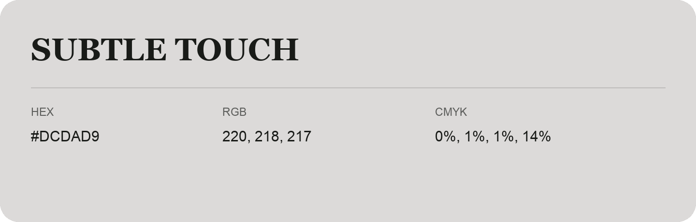

## Subtle Touch

- HEX: #DCDAD9
- RGB: 220, 218, 217
- CMYK: 0%, 1%, 1%, 14%
- Character: quiet, balanced, understated
- Suggested uses: professional services, minimal identities, supporting backgrounds

- Source images: IMG_9115.JPG
