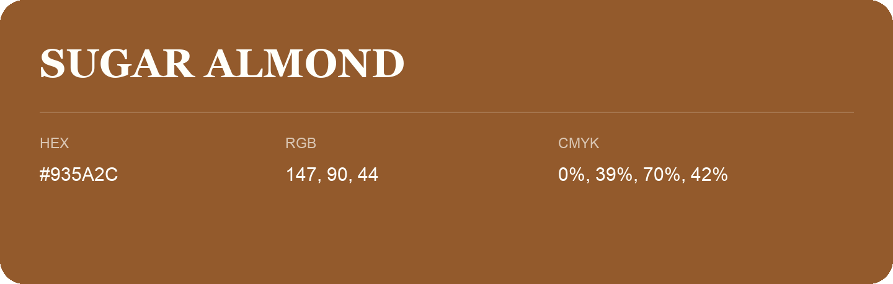

## Sugar Almond

- HEX: #935A2C
- RGB: 147, 90, 44
- CMYK: 0%, 39%, 70%, 42%
- Character: earthy, rich, warm
- Suggested uses: artisan businesses, hospitality brands, warm accents

- Source images: iCloud Photos 2/IMG_9126.JPG
