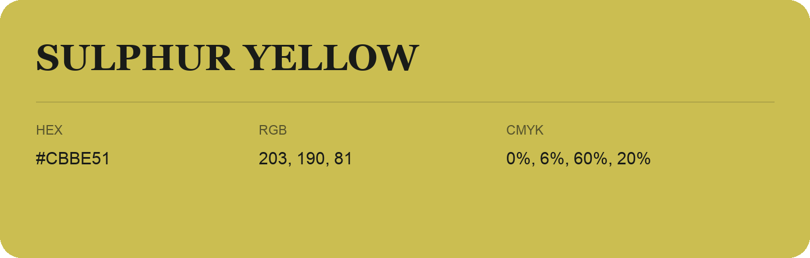

## Sulphur Yellow

- HEX: #CBBE51
- RGB: 203, 190, 81
- CMYK: 0%, 6%, 60%, 20%
- Character: sunny, lively, optimistic
- Suggested uses: friendly consumer brands, food packaging, cheerful accents

- Source images: iCloud Photos 2/IMG_9141.JPG
- Data provenance: RGB calculated from HEX; source text recognition was uncertain.
