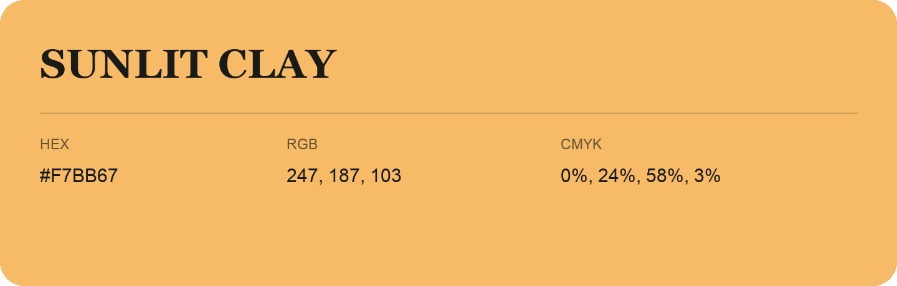

## Sunlit Clay

- HEX: #F7BB67
- RGB: 247, 187, 103
- CMYK: 0%, 24%, 58%, 3%
- Character: earthy, rich, warm
- Suggested uses: artisan businesses, hospitality brands, warm accents

- Source images: IMG_8993.JPG
