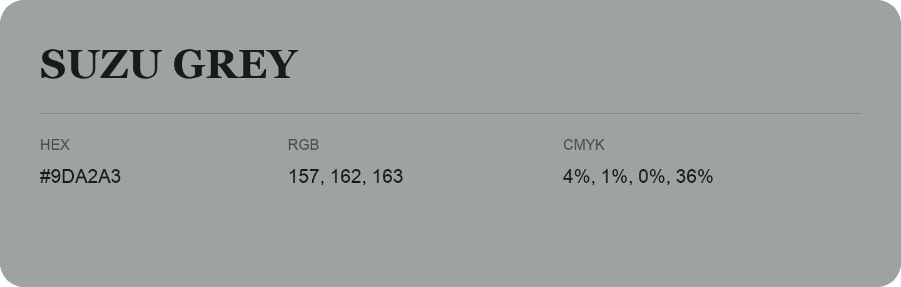

## Suzu Grey

- HEX: #9DA2A3
- RGB: 157, 162, 163
- CMYK: 4%, 1%, 0%, 36%
- Character: quiet, balanced, understated
- Suggested uses: professional services, minimal identities, supporting backgrounds

- Source images: IMG_9113.JPG

- Data provenance: RGB calculated from HEX, matching the page; source image RGB was unreadable.
