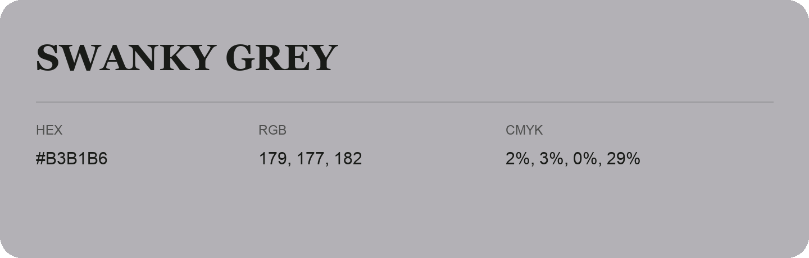

## Swanky Grey

- HEX: #B3B1B6
- RGB: 179, 177, 182
- CMYK: 2%, 3%, 0%, 29%
- Character: quiet, balanced, understated
- Suggested uses: professional services, minimal identities, supporting backgrounds

- Source images: IMG_9010.JPG

- Data provenance: RGB calculated from HEX, matching the page; source image RGB was unreadable.
