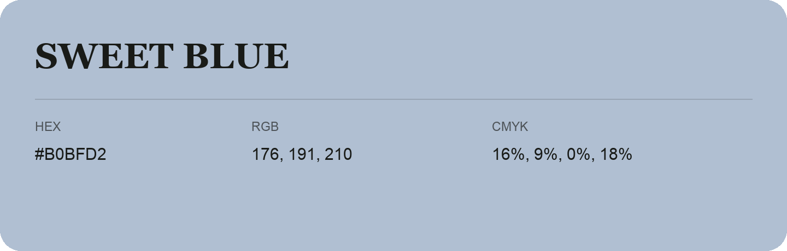

## Sweet Blue

- HEX: #B0BFD2
- RGB: 176, 191, 210
- CMYK: 16%, 9%, 0%, 18%
- Character: soft, gentle, approachable
- Suggested uses: friendly consumer brands, gentle backgrounds, welcoming accents

- Source images: IMG_9045.JPG

- Data provenance: HEX recovered from page data; cross-checked against the readable source RGB.
