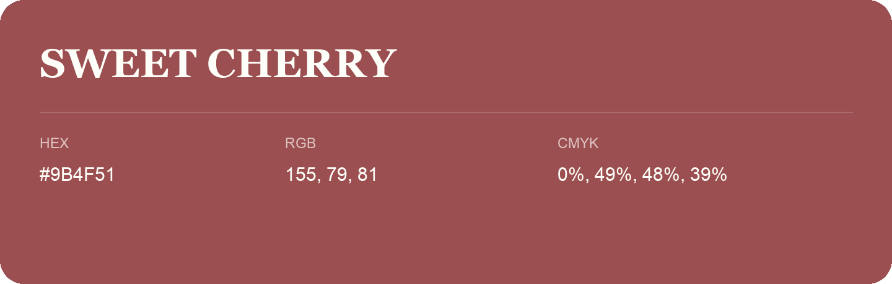

## Sweet Cherry

- HEX: #9B4F51
- RGB: 155, 79, 81
- CMYK: 0%, 49%, 48%, 39%
- Character: warm, expressive, energetic
- Suggested uses: food brands, expressive identities, promotional accents

- Source images: iCloud Photos 2/IMG_9152.JPG
