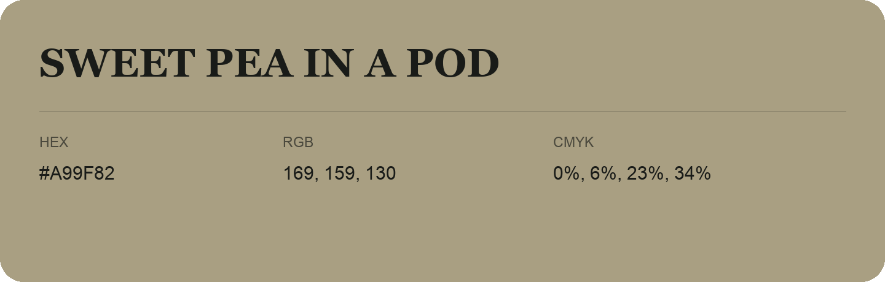

## Sweet Pea in a Pod

- HEX: #A99F82
- RGB: 169, 159, 130
- CMYK: 0%, 6%, 23%, 34%
- Character: earthy, rich, warm
- Suggested uses: artisan businesses, hospitality brands, warm accents

- Source images: IMG_9051.JPG
