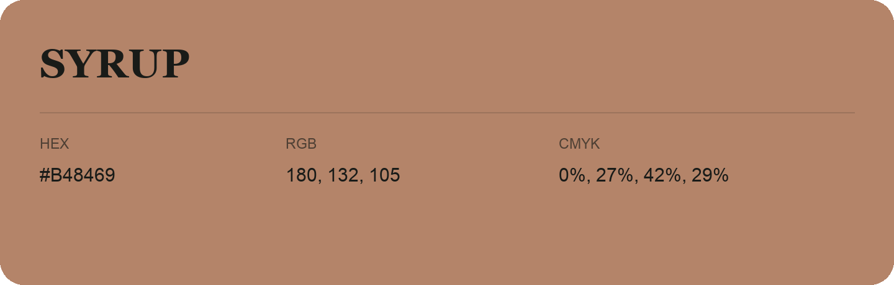

## Syrup

- HEX: #B48469
- RGB: 180, 132, 105
- CMYK: 0%, 27%, 42%, 29%
- Character: earthy, rich, warm
- Suggested uses: artisan businesses, hospitality brands, warm accents

- Source images: iCloud Photos 2/IMG_9166.JPG
