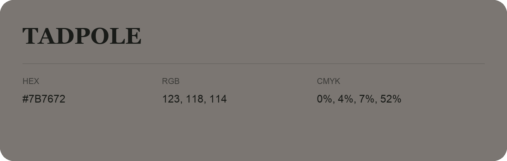

## Tadpole

- HEX: #7B7672
- RGB: 123, 118, 114
- CMYK: 0%, 4%, 7%, 52%
- Character: restrained, grounded, sophisticated
- Suggested uses: premium brands, editorial typography, dark backgrounds

- Source images: IMG_9053.JPG
