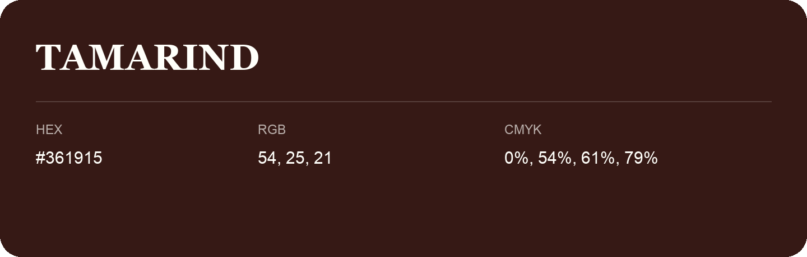

## Tamarind

- HEX: #361915
- RGB: 54, 25, 21
- CMYK: 0%, 54%, 61%, 79%
- Character: deep, grounded, understated
- Suggested uses: premium packaging, editorial typography, dark backgrounds

- Source images: iCloud Photos 2/IMG_9129.JPG

- Name note: Other distinct shades share this name: [tamarind-371714](tamarind-371714.md).
