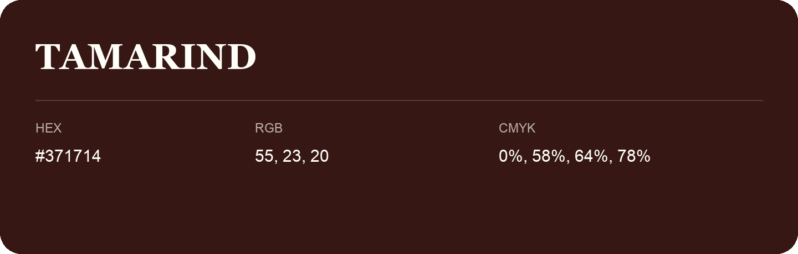

## Tamarind

- HEX: #371714
- RGB: 55, 23, 20
- CMYK: 0%, 58%, 64%, 78%
- Character: warm, expressive, energetic
- Suggested uses: food brands, expressive identities, promotional accents

- Source images: IMG_9093.JPG

## Consolidated source variants

This is the canonical library entry. Same-name variants below are within ΔE00 ≤ 1 of this shade and were consolidated editorially. Their source values are preserved; they were not source errors.

### Source variant #361611

- HEX: #361611
- RGB: 54, 22, 17
- CMYK: 0%, 59%, 69%, 79%
- Difference from canonical: ΔE00 0.9315.
- Source images: iCloud Photos 2/IMG_9122.JPG

- Name note: Other distinct shades share this name: [tamarind-361915](tamarind-361915.md).
