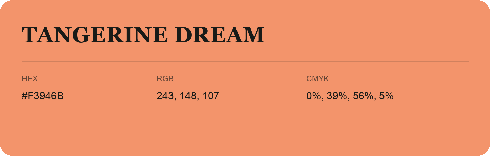

## Tangerine Dream

- HEX: #F3946B
- RGB: 243, 148, 107
- CMYK: 0%, 39%, 56%, 5%
- Character: earthy, rich, warm
- Suggested uses: artisan businesses, hospitality brands, warm accents

- Source images: IMG_8993.JPG
