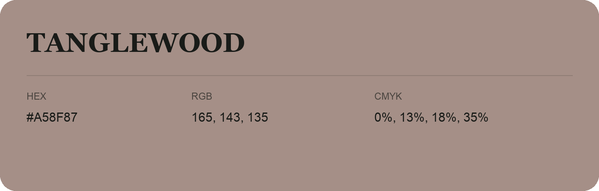

## Tanglewood

- HEX: #A58F87
- RGB: 165, 143, 135
- CMYK: 0%, 13%, 18%, 35%
- Character: earthy, rich, warm
- Suggested uses: artisan businesses, hospitality brands, warm accents

- Source images: IMG_9016.JPG
