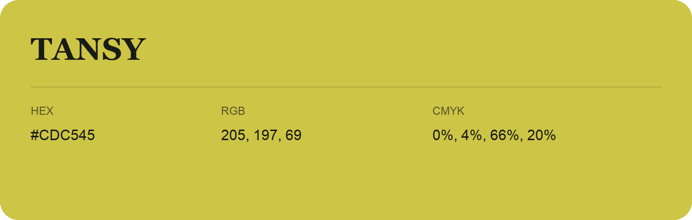

## Tansy

- HEX: #CDC545
- RGB: 205, 197, 69
- CMYK: 0%, 4%, 66%, 20%
- Character: sunny, lively, optimistic
- Suggested uses: friendly consumer brands, food packaging, cheerful accents

- Source images: IMG_9111.JPG
