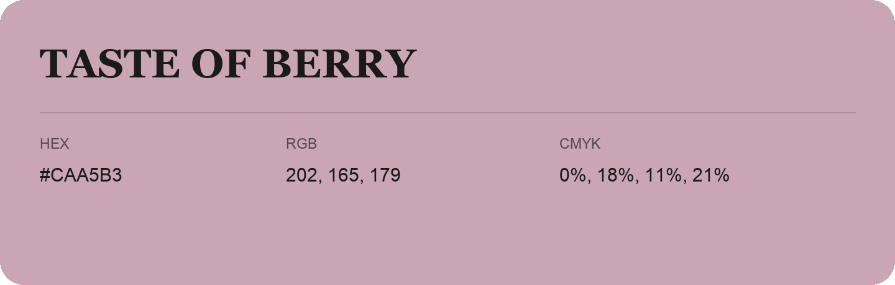

## Taste Of Berry

- HEX: #CAA5B3
- RGB: 202, 165, 179
- CMYK: 0%, 18%, 11%, 21%
- Character: soft, warm, playful
- Suggested uses: friendly consumer brands, gentle backgrounds, welcoming accents

- Source images: IMG_9046.JPG

- Data provenance: RGB calculated from HEX, matching the page; source image RGB was unreadable.
