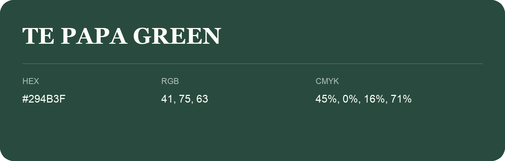

## Te Papa Green

- HEX: #294B3F
- RGB: 41, 75, 63
- CMYK: 45%, 0%, 16%, 71%
- Character: natural, grounded, fresh
- Suggested uses: outdoor businesses, wellness brands, organic packaging

- Source images: IMG_9067.JPG
