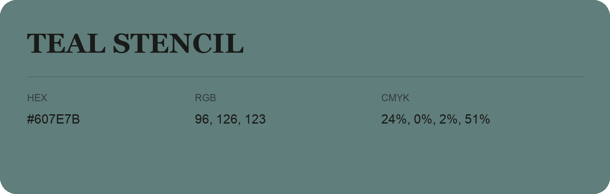

## Teal Stencil

- HEX: #607E7B
- RGB: 96, 126, 123
- CMYK: 24%, 0%, 2%, 51%
- Character: calm, fresh, composed
- Suggested uses: wellness brands, coastal hospitality, modern service brands

- Source images: IMG_9004.JPG
