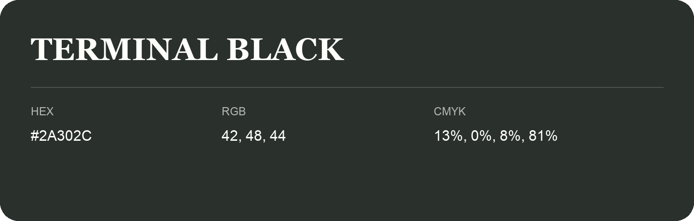

## Terminal Black

- HEX: #2A302C
- RGB: 42, 48, 44
- CMYK: 13%, 0%, 8%, 81%
- Character: restrained, grounded, sophisticated
- Suggested uses: premium brands, editorial typography, dark backgrounds

- Source images: IMG_9115.JPG
