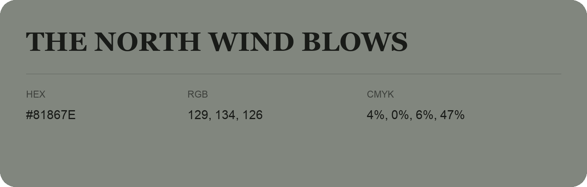

## The North Wind Blows

- HEX: #81867E
- RGB: 129, 134, 126
- CMYK: 4%, 0%, 6%, 47%
- Character: quiet, balanced, understated
- Suggested uses: professional services, minimal identities, supporting backgrounds

- Source images: IMG_9038.JPG

- Data provenance: RGB calculated from HEX, matching the page; source image RGB was unreadable.
