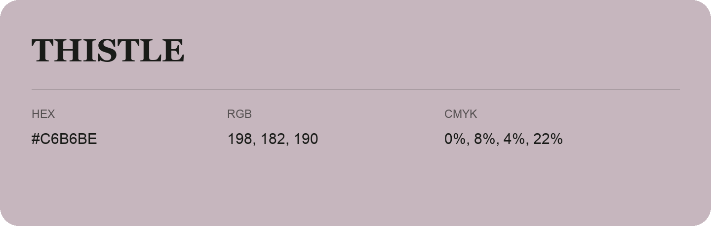

## Thistle

- HEX: #C6B6BE
- RGB: 198, 182, 190
- CMYK: 0%, 8%, 4%, 22%
- Character: quiet, balanced, understated
- Suggested uses: professional services, minimal identities, supporting backgrounds

- Source images: IMG_8991.JPG

- Data provenance: RGB calculated from HEX, matching the page; source image RGB was unreadable.
