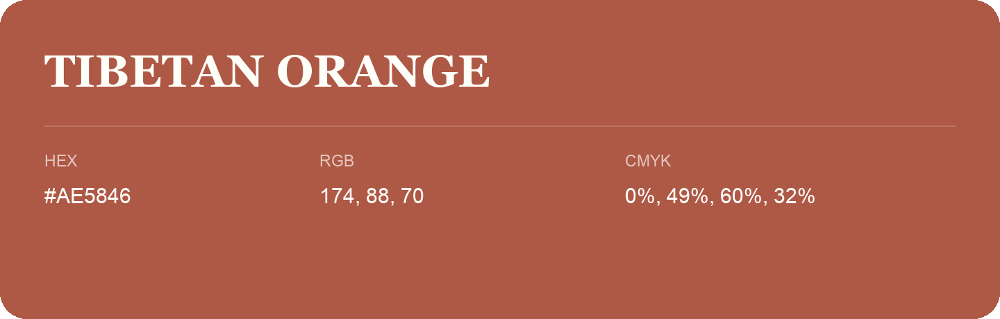

## Tibetan Orange

- HEX: #AE5846
- RGB: 174, 88, 70
- CMYK: 0%, 49%, 60%, 32%
- Character: warm, expressive, energetic
- Suggested uses: food brands, expressive identities, promotional accents

- Source images: IMG_9088.JPG
