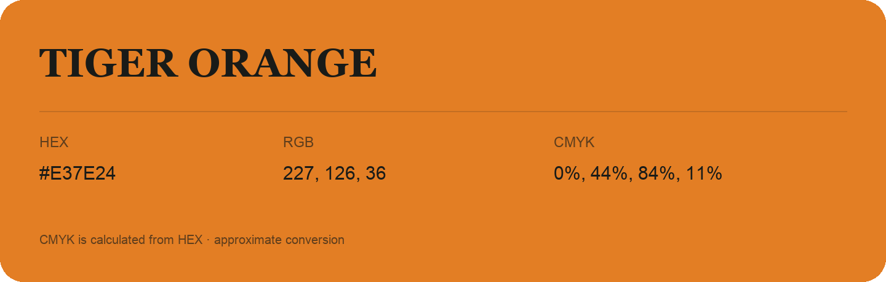

## Tiger Orange

- HEX: #E37E24
- RGB: 227, 126, 36
- CMYK: 0%, 44%, 84%, 11%
- Character: earthy, rich, warm
- Suggested uses: artisan businesses, hospitality brands, warm accents

- Source images: IMG_8988.JPG

- Data provenance: CMYK calculated from HEX using the page’s conversion; source image CMYK was unreadable. This is an approximate conversion without a print color profile.
