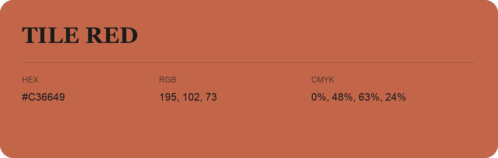

## Tile Red

- HEX: #C36649
- RGB: 195, 102, 73
- CMYK: 0%, 48%, 63%, 24%
- Character: warm, expressive, energetic
- Suggested uses: food brands, expressive identities, promotional accents

- Source images: IMG_9106.JPG
