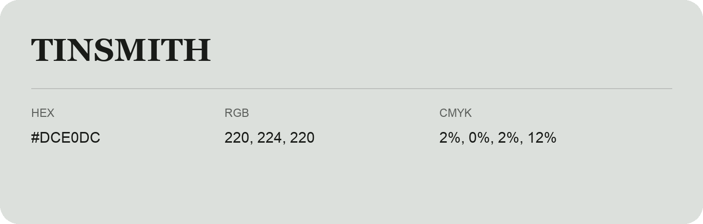

## Tinsmith

- HEX: #DCE0DC
- RGB: 220, 224, 220
- CMYK: 2%, 0%, 2%, 12%
- Character: quiet, balanced, understated
- Suggested uses: professional services, minimal identities, supporting backgrounds

- Source images: IMG_9047-1.JPG

- Data provenance: HEX recovered from page data; cross-checked against the readable source RGB.
