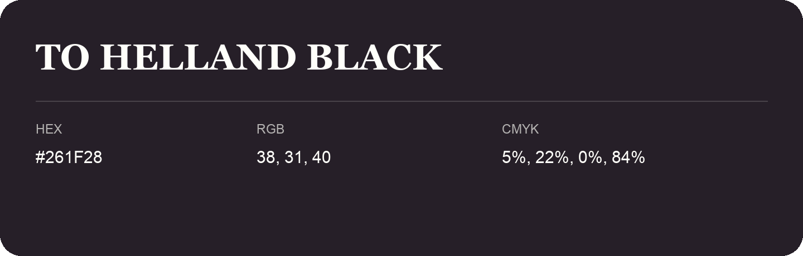

## To Helland Black

- HEX: #261F28
- RGB: 38, 31, 40
- CMYK: 5%, 22%, 0%, 84%
- Character: deep, grounded, understated
- Suggested uses: premium packaging, editorial typography, dark backgrounds

- Source images: IMG_9019.JPG

## Consolidated source variants

This is the canonical library entry. Same-name variants below are within ΔE00 ≤ 1 of this shade and were consolidated editorially. Their source values are preserved; they were not source errors.

### Source variant #251F29

- HEX: #251F29
- RGB: 37, 31, 41
- CMYK: 10%, 24%, 0%, 84%
- Difference from canonical: ΔE00 0.7513.
- Source images: IMG_9030.JPG
