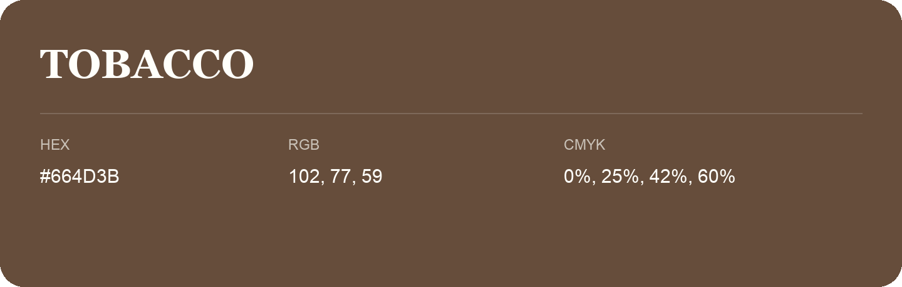

## Tobacco

- HEX: #664D3B
- RGB: 102, 77, 59
- CMYK: 0%, 25%, 42%, 60%
- Character: earthy, rich, warm
- Suggested uses: premium packaging, rustic brands, dark backgrounds

- Source images: IMG_9112.JPG
